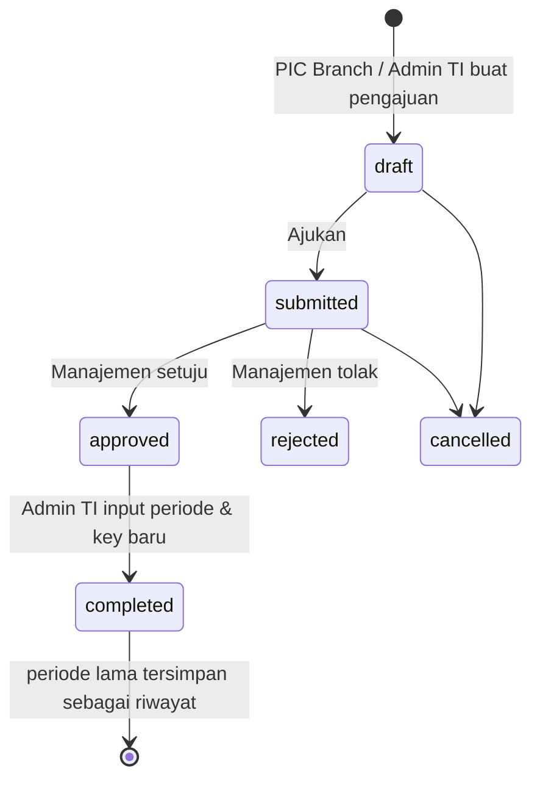
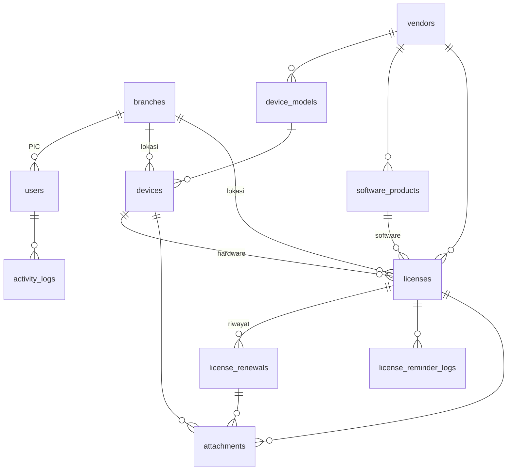

# Sistem Monitoring Lisensi TI — Desain Role & Database

## 1. Kekurangan referensi (`public/referensi/*.html`) yang diperbaiki

| Referensi | Masalah | Desain baru |
|---|---|---|
| Toggle `ADMIN`/`VIEWER` di pojok kanan | Bukan login, siapa pun bisa jadi admin | Login + 4 role + scope per branch |
| Data hardcode di JS, hilang saat refresh | Tidak persisten | MySQL |
| Perangkat & lisensi digabung jadi satu baris | 1 perangkat tidak bisa punya >1 lisensi (subscription + warranty) | Tabel `devices` dan `licenses` terpisah |
| Vendor/tipe/kategori hardcode (3 vendor) | Tambah vendor = ubah kode | Master `vendors`, `device_models`, `branches` |
| Hanya hardware | Lisensi software tidak bisa dicatat | `asset_type` hardware/software + `software_products` |
| Peringatan hanya H-4 | Terlalu mepet untuk proses pengadaan | Status Aktif / Akan Habis (≤90) / Kritis (≤30) / Expired, reminder H-90/60/30/14/7/1 (bisa diatur) |
| Renewal langsung timpa data | Tidak ada persetujuan | Alur pengajuan → persetujuan Manajemen → eksekusi Admin TI |
| Log hanya renewal, `renewedBy` hardcode | Tidak bisa audit | `license_renewals` (riwayat) + `activity_logs` (audit semua aksi) |
| Foto disimpan base64 | Berat, tidak ada dokumen lain | `attachments` ke storage: sertifikat, foto SN, PO, invoice, kontrak, BAST |
| License key dikarang & tampil terbuka | Data sensitif, dan tidak semua lisensi punya key | `key_format`: tanpa key / kode teks (terenkripsi) / foto (mis. MS Office); hanya role tertentu yang bisa lihat |

## 2. Role & hak akses

| Hak akses | Super Admin | Admin TI | Manajemen | PIC Branch |
|---|:-:|:-:|:-:|:-:|
| Cakupan data | Semua | Semua | Semua | **Branch sendiri** |
| Dashboard | ✔ | ✔ | ✔ | ✔ |
| Lihat perangkat & lisensi | ✔ | ✔ | ✔ | ✔ |
| Tambah/ubah/hapus perangkat & lisensi | ✔ | ✔ | – | – |
| Lihat license key | ✔ | ✔ | – | – |
| Ajukan perpanjangan | ✔ | ✔ | – | ✔ |
| Setujui / tolak perpanjangan | ✔ | – | ✔ | – |
| Selesaikan perpanjangan (input lisensi baru) | ✔ | ✔ | – | – |
| Upload lampiran | ✔ | ✔ | – | ✔ |
| Laporan & export | ✔ | ✔ | ✔ | – |
| Audit log | ✔ | ✔ | ✔ | – |
| Kelola user, master data, pengaturan reminder | ✔ | – | – | – |

Sumber kebenaran: `app/Enums/UserRole.php` (`permissions()`).

> Catatan UI: Super Admin secara izin punya akses penuh (`*`), tetapi menunya difokuskan ke administrasi sistem
> (user, master data, pengaturan, audit). Pekerjaan operasional lisensi dilakukan lewat akun Admin TI.

## 3. Alur perpanjangan



## 4. ERD



| Tabel | Isi |
|---|---|
| `branches` | Lokasi (Kantor Pusat / Branch / Terminal) |
| `users` | Akun + `role` + `branch_id` |
| `vendors` | Principal: Palo Alto, Sangfor, HPE Aruba, Microsoft, … |
| `device_models` | PA-440, PA-3410, IAG 50/51/52, HPE 5710/5520, … |
| `devices` | Unit fisik (SN unik, hostname, IP, status) |
| `software_products` | Produk software |
| `licenses` | Lisensi aktif: tipe, paket, `key_format` + key (encrypted) / foto key (attachment), seat, start/end, biaya, PO |
| `license_renewals` | Pengajuan + riwayat perpanjangan (snapshot periode lama & baru) |
| `attachments` | File lampiran polimorfik |
| `license_reminder_logs` | Reminder yang sudah terkirim (anti dobel) |
| `activity_logs` | Audit trail |
| `settings` | Ambang status & hari reminder |
| `notifications` | Notifikasi in-app |

Status masa berlaku **tidak disimpan**, dihitung dari `end_date` (`License::expiry_status`, scope `whereExpiryStatus`).

## 5. Menjalankan

```bash
# buat database "sistem-monitoring-lisensi" di MySQL, set DB_DATABASE di .env
php artisan migrate        # schema + data asli dari Excel
php artisan db:seed        # akun demo (opsional, development)
```

Akun demo (password `password`): `superadmin`, `admin.ti`, `manajemen`, `pic.bima`, `pic.makassar`.
